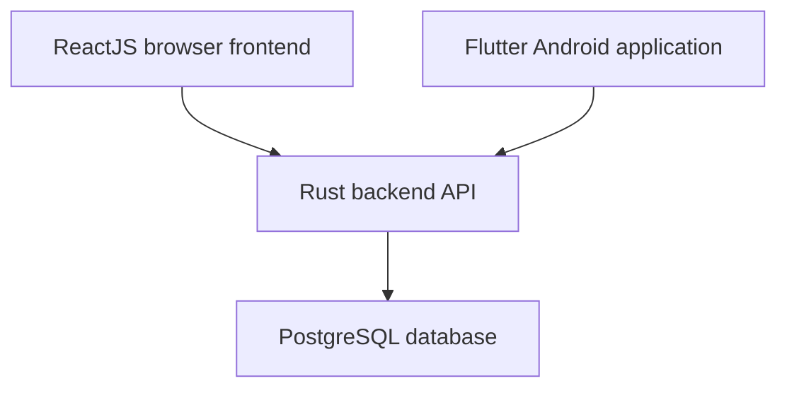

# Architecture Decision Records

These records document AREHAJ's accepted technology selections. **Accepted** records a project decision, not a claim that implementation, benchmarking, security review, or production deployment is complete.

## Decision Index

| ADR                                          | Decision                                     | Status   | Date       |
| -------------------------------------------- | -------------------------------------------- | -------- | ---------- |
| [0001](0001-use-rust-for-backend.md)         | Use Rust for the backend                     | Accepted | 2026-11-23 |
| [0002](0002-use-reactjs-for-web-frontend.md) | Use ReactJS for the browser frontend         | Accepted | 2026-11-23 |
| [0003](0003-use-flutter-for-android.md)      | Use Flutter for the Android application      | Accepted | 2026-11-23 |
| [0004](0004-use-postgresql-for-database.md)  | Use PostgreSQL as the authoritative database | Accepted | 2026-11-23 |

## Selected Architecture

The browser and Android application are separate clients. Authorization, business rules, and authoritative database access remain on the backend. Flutter is an installable Android application, not a web frontend packaged into an APK.

The records do not select a Rust web framework, React build/rendering framework, hosting provider, ORM, mobile-local database, or offline synchronization mechanism. Record significant follow-up choices separately rather than treating these technologies as implicit dependencies.

## Record Conventions

- Give each new ADR the next available four-digit number and a descriptive filename.
- Record status, date, context, decision, rationale, alternatives, consequences, and outstanding work.
- Link supporting studies and related decisions.
- If an accepted decision changes, add a new ADR and mark the old record as superseded with a link; preserve its historical reasoning.

## Supporting Comparative Studies

- [Backend languages](../comparative%20studies/Backend-Language-Comparison.md)
- [Browser frontend technologies](../comparative%20studies/Web-Frontend-Comparison.md)
- [Android frontend technologies](../comparative%20studies/Frontend-Language-Comparison.md)
- [Databases](../comparative%20studies/Database-Comparison.md)
