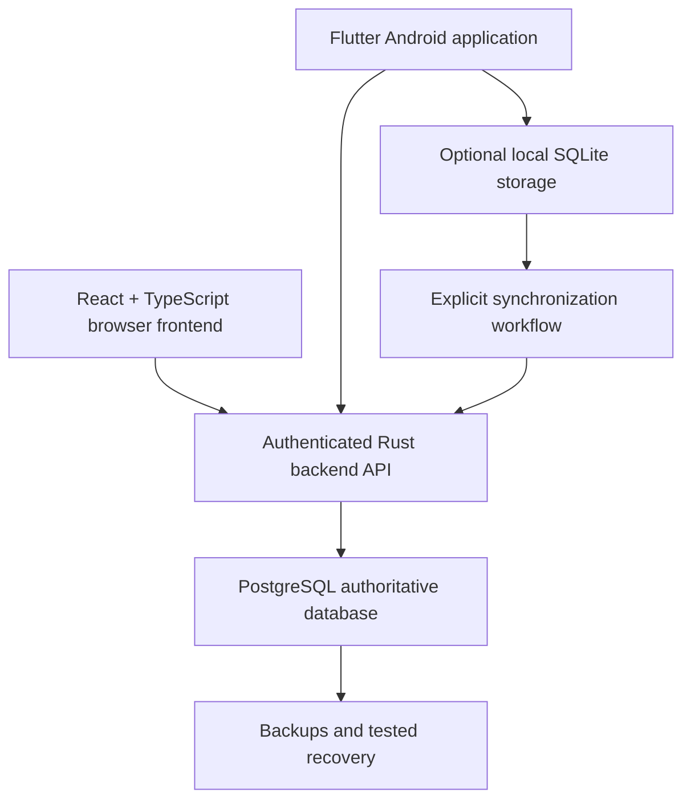
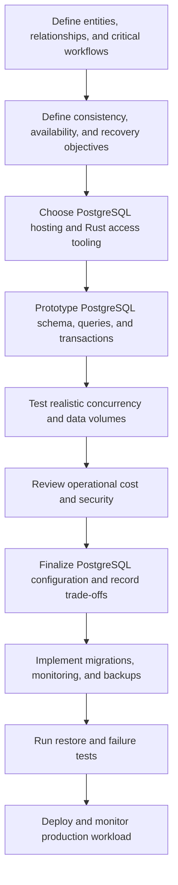

# Database Technology Comparison Study

**Purpose**: Document the selection of PostgreSQL for the application's backend and retain a comparison with database alternatives.  
**Last Updated**: 2026-11-23  
**Study Scope**: Authoritative application storage behind a backend API shared by browser and Android clients. Android-local storage is considered separately and does not replace the server database.

**Candidates**: PostgreSQL, MySQL with InnoDB, SQLite, and MongoDB.

## Project Technology Decision

**Selected stack**: Rust backend, React with TypeScript browser frontend, Flutter (Dart) Android application, and PostgreSQL database.

**PostgreSQL is the selected authoritative database for AREHAJ.** The Rust backend accesses it; React with TypeScript and Flutter clients communicate through the API, without embedded database credentials. Alternatives below are retained as comparison background, not an open database selection or evidence of implementation.

The application schema, expected traffic, hosting environment, availability objectives, and compliance requirements have not been established for this study. The database choice is settled, but its sizing, configuration, hosting, and recovery design still require validation.

---

## Executive Summary

| Database           | Data model                              | Main strength                                                        | Main trade-off                                                                          | Typical role                                                            |
| ------------------ | --------------------------------------- | -------------------------------------------------------------------- | --------------------------------------------------------------------------------------- | ----------------------------------------------------------------------- |
| **PostgreSQL**     | Relational with JSONB and extensibility | Strong relational integrity, flexible queries, and rich SQL features | Requires server operations and deliberate query/index management                        | Default candidate for a general-purpose application backend             |
| **MySQL / InnoDB** | Relational with JSON support            | Established transactional database with broad hosting support        | SQL behavior and feature coverage differ from PostgreSQL                                | Strong alternative where team experience or infrastructure favors MySQL |
| **SQLite**         | Embedded relational database            | Simple deployment without a separate database server                 | One writer at a time per database; distributed deployment needs additional architecture | Android-local storage or a modest single-instance backend               |
| **MongoDB**        | Document database with BSON             | Natural storage of document-shaped aggregates                        | Cross-document relationships and invariants require careful modeling                    | Document-centric applications with demonstrated access-pattern benefits |

**Key Findings**:

- **PostgreSQL is selected for this project's authoritative backend storage**, with relational integrity, transactions, and flexible querying as relevant capabilities.
- **MySQL is a credible peer**, not a categorically slower or less secure option. Existing operational expertise can be decisive.
- **SQLite is well suited to local storage** and can also serve some production backends. Evaluate write concurrency and deployment topology rather than dismissing it based on database size alone.
- **MongoDB is conditional on document-oriented requirements**. Flexible documents do not eliminate schema design, validation, migrations, or transactions.
- Browser and Android applications should access authoritative data through the backend API, not connect directly using database credentials embedded in the client.

**Methodology**: Qualitative architecture comparison, not a measured benchmark. No project-specific workload, deployment, cost estimate, or failover test has been run. Official documentation links are provided at the end; live documentation, product versions, provider offerings, and license terms were not verified during this revision.

---

## 1. PostgreSQL

### Architecture Overview

PostgreSQL is a client/server relational database with SQL, multiversion concurrency control (MVCC), transactions, foreign keys, and extensible data types and indexing. JSONB supports structured document storage and indexing alongside relational tables; it does not remove the need to model frequently queried fields and relationships carefully.

**Technical Stack**:

- Storage model: Tables, constraints, relationships, JSONB where appropriate.
- Access: SQL through a backend driver, query builder, or ORM.
- Indexing: B-tree and specialized index types such as GIN, selected for actual query patterns.
- Operations: Write-ahead logging, backups, replication, vacuuming, statistics, and connection management.
- Deployment: Self-hosted server or managed PostgreSQL service; extensions and administrative access vary by provider.

### Production Readiness Assessment

| Area         | Assessment                                                                                               |
| ------------ | -------------------------------------------------------------------------------------------------------- |
| Transactions | Strong transactional support; choose isolation levels deliberately and handle retries where required     |
| Integrity    | Foreign keys, unique constraints, check constraints, and other database-enforced invariants              |
| Querying     | Rich SQL, joins, aggregations, window functions, and JSON operations                                     |
| Security     | Roles, privileges, TLS configuration, and row-level security where deliberately configured               |
| Operations   | Mature tooling, but backup recovery, vacuum health, indexes, connections, and upgrades require ownership |

### Advantages

- Strong fit for related application data and multi-step business transactions.
- Flexible querying supports changing administrative and reporting requirements.
- JSONB can accommodate selected variable attributes without moving the entire model to a document database.
- Extensions can support specialized needs, subject to provider availability and maintenance policy.
- PostgreSQL uses a permissive open-source license; managed services still have their own pricing and terms.

### Disadvantages

- Schema changes and index creation must be planned to control locks and deployment risk.
- Long transactions and poorly maintained workloads can cause table/index bloat and operational problems.
- Connection limits require pooling or other connection management as concurrency grows.
- Replicas and extensions add operational complexity; neither is automatically necessary for an initial deployment.

### Production Readiness Summary

A strong default for a transactional application backend. Start with a maintainable schema and measured indexing, then add operational complexity only when workload or recovery requirements justify it.

---

## 2. MySQL with InnoDB

### Architecture Overview

MySQL is a client/server relational database. This comparison assumes InnoDB, its transactional storage engine, rather than treating every MySQL storage engine as equivalent. InnoDB supports transactions, row-level locking, MVCC, and foreign keys. MySQL also provides JSON data types and operations.

**Technical Stack**:

- Storage model: Relational tables, constraints, and selected JSON columns.
- Access: SQL through backend drivers and common ORM/query-builder ecosystems.
- Indexing: Primarily B-tree indexes, with specialized capabilities where supported.
- Operations: InnoDB recovery mechanisms, binary logging, backups, and replication.
- Deployment: Self-hosted or managed service; feature availability depends on version and service.

### Production Readiness Assessment

| Area         | Assessment                                                                                      |
| ------------ | ----------------------------------------------------------------------------------------------- |
| Transactions | InnoDB supports multi-statement transactions; isolation and locking behavior must be understood |
| Integrity    | Foreign keys and uniqueness; verify constraint behavior for the selected version and schema     |
| Querying     | Established SQL capabilities, including joins and analytical SQL features in modern releases    |
| Security     | Accounts, privileges, TLS, and service-specific controls require configuration                  |
| Operations   | Broad ecosystem; replication, recovery, upgrades, and slow-query management still need testing  |

### Advantages

- Established hosting, tooling, and developer ecosystem.
- Good option for teams already experienced with MySQL administration and query behavior.
- Suitable for many transactional application workloads.
- Available through numerous managed providers.

### Disadvantages

- PostgreSQL and MySQL differ in SQL semantics, JSON querying, indexing, collations, and migration behavior.
- Storage engine, SQL modes, character sets, and configuration affect correctness and compatibility.
- Replication does not automatically provide transparent failover or eliminate stale reads.
- Community, commercial, and managed offerings differ; verify licensing and required operational features.

### Production Readiness Summary

A strong alternative when operational familiarity, existing schema, or hosting support favors it. Do not migrate between MySQL and PostgreSQL on the assumption that SQL compatibility makes the change trivial.

---

## 3. SQLite

### Architecture Overview

SQLite is an embedded SQL database accessed as a library rather than through a separate database server. A database is commonly stored in a local file, with associated journal or write-ahead-log files depending on configuration. It supports transactions, indexes, joins, and constraints.

SQLite is used on Android; Room provides an abstraction over it for many native Android applications. The appropriate integration for Flutter or React Native depends on the selected mobile libraries.

**Technical Stack**:

- Storage model: Embedded relational database.
- Access: In-process library through language bindings or Android database tooling.
- Concurrency: Multiple readers; one writer at a time per database. WAL can allow readers and a writer to proceed concurrently.
- Integrity: Enable and verify foreign-key enforcement for each connection rather than assuming it is active.
- Deployment: Local persistent storage with an explicit backup and file-access strategy.

### Production Readiness Assessment

| Area         | Assessment                                                                                                |
| ------------ | --------------------------------------------------------------------------------------------------------- |
| Transactions | ACID transactions, with durability dependent on settings and the storage environment                      |
| Integrity    | Constraints available; verify foreign-key enforcement and consider STRICT tables where appropriate        |
| Querying     | Capable SQL engine, with differences from PostgreSQL and MySQL                                            |
| Security     | File/device access controls are central; no built-in database-server user/role boundary                   |
| Operations   | Simple initial deployment, but live backups, write contention, and persistent volumes still need planning |

### Advantages

- No separate database service to provision or maintain.
- Useful for local caches, offline Android workflows, tests, and some single-instance services.
- Transactions and SQL without a client/server network round trip.
- Low infrastructure overhead for suitable workloads.

### Disadvantages

- A single writer per database can constrain write-heavy concurrent workloads.
- Multiple application replicas cannot simply treat independent database files as one shared database.
- Sharing a database file over a network filesystem can introduce locking and reliability hazards.
- Standard SQLite does not provide transparent client/server replication or Android-to-backend synchronization.
- Encryption at rest requires an appropriate platform/storage solution or a reviewed encryption extension; it is not implied by using SQLite.

### Production Readiness Summary

An excellent local-storage candidate and a legitimate backend choice when topology and concurrency fit. For a backend expected to run multiple writable application instances, PostgreSQL or MySQL is generally the more straightforward starting point.

---

## 4. MongoDB

### Architecture Overview

MongoDB stores BSON documents in collections. Related data can be embedded in a document or represented by references, depending on access patterns, update frequency, and growth. MongoDB supports schema validation, indexes, aggregation pipelines, and multi-document transactions on supported replica-set or sharded deployments.

**Technical Stack**:

- Storage model: BSON documents organized into collections.
- Access: MongoDB drivers and aggregation/query APIs rather than relational SQL as the primary interface.
- Integrity: Document validation, indexes, atomic document operations, and transactions where appropriate.
- Operations: Replica sets for redundancy; sharding is available but adds substantial design and operational work.
- Deployment: Self-managed or managed service; check current licensing and feature availability.

### Production Readiness Assessment

| Area         | Assessment                                                                                              |
| ------------ | ------------------------------------------------------------------------------------------------------- |
| Transactions | Single-document atomicity; multi-document transactions available with supported deployment requirements |
| Integrity    | Validation and unique indexes help; no relational foreign-key enforcement between collections           |
| Querying     | Document queries and aggregation; lookup operations exist but are not identical to relational modeling  |
| Security     | Authentication, authorization, TLS, network access, and audit requirements must be configured           |
| Operations   | Mature capabilities, but replication, consistency settings, backups, and sharding need expertise        |

### Advantages

- Natural representation for bounded document aggregates commonly read and updated together.
- Documents can evolve while maintaining validation appropriate to each stage of a migration.
- Supports indexing and aggregation over document structures.
- Useful where a document model provides a concrete simplification over tables and joins.

### Disadvantages

- Denormalization can duplicate data and increase update-consistency work.
- Cross-collection relationships lack relational foreign-key enforcement.
- Document growth, indexing, and partitioning require careful design; flexible schema is not schema-free operation.
- Transactions exist but do not make relational and document designs interchangeable.
- MongoDB Community Server uses the SSPL; assess current terms and organizational policy rather than treating all database licenses as equivalent.

### Production Readiness Summary

A conditional choice when document-oriented access patterns justify it. Do not select it solely to avoid migrations or because horizontal scaling might be needed someday.

---

## Benchmark Comparison Details

### Metrics to Measure

No universal throughput, latency, storage-size, or cost figures are asserted. Results depend on schema, queries, indexes, working-set size, hardware, durability settings, and concurrency.

| Metric           | Evaluation method                                                                                       |
| ---------------- | ------------------------------------------------------------------------------------------------------- |
| Read latency     | Measure representative queries and tail latency with realistic filters, sorting, joins, or aggregations |
| Write latency    | Exercise actual transactions and concurrent updates under required durability guarantees                |
| Throughput       | Increase concurrency until the application's latency or error objectives fail                           |
| Correctness      | Test constraints, conflicting updates, retries, and duplicate request handling                          |
| Storage          | Include tables/documents, indexes, transaction logs, backups, and retention                             |
| Recovery         | Restore backups and measure data loss and recovery time against objectives                              |
| Failure behavior | Test database interruption, connection exhaustion, and replica/failover behavior if used                |
| Operating cost   | Include service, storage, I/O, backups, networking, monitoring, and engineering time                    |

Use equivalent business behavior and durability requirements, not merely similar-looking queries. Record database versions, configuration, dataset, cache state, connection pool settings, and test duration. Separate database time from API serialization and network latency.

### Ecosystem Evaluation

Check the selected backend language's driver maturity, pooling, transaction support, migration tooling, observability, and ORM behavior. A shared ORM does not make all databases interchangeable; verify generated SQL and support for the features the design relies on.

---

## Recommendation Matrix

The following matrix and scenarios describe general suitability. **AREHAJ uses PostgreSQL**; MySQL and MongoDB remain comparison alternatives. Android-local storage is a separate, optional decision.

| Requirement                                                | Preferred starting point                                   | Qualification                                                         |
| ---------------------------------------------------------- | ---------------------------------------------------------- | --------------------------------------------------------------------- |
| Related entities and transactional workflows               | PostgreSQL or MySQL/InnoDB                                 | Enforce key invariants with constraints and transactions              |
| Flexible attributes alongside relational data              | PostgreSQL JSONB or MySQL JSON                             | Keep frequently queried relationships and fields deliberately modeled |
| Existing MySQL operations and schema                       | MySQL/InnoDB                                               | Existing expertise may outweigh a theoretical feature advantage       |
| Android offline storage                                    | SQLite, often through Room or a framework-specific library | Requires separate synchronization design                              |
| Modest single-instance backend                             | SQLite, PostgreSQL, or MySQL                               | Decide using write concurrency, recovery, and deployment needs        |
| Document aggregates with limited cross-document invariants | MongoDB                                                    | Validate schema, document growth, consistency, and transaction needs  |
| Multiple backend instances sharing authoritative data      | PostgreSQL, MySQL, or MongoDB                              | Connection management and concurrency control still matter            |
| Conventional new backend with unspecified workload         | PostgreSQL                                                 | Provisional recommendation pending schema and workload validation     |

### Scenario A: New Transactional Web Backend

**Preferred starting point**: PostgreSQL.  
**Reason**: Relational integrity and flexible querying provide a useful baseline without requiring a specialized storage model.

### Scenario B: Existing MySQL Infrastructure

**Preferred starting point**: MySQL/InnoDB.  
**Reason**: Reuse proven operational practices unless a concrete PostgreSQL feature or measured requirement justifies migration.

### Scenario C: Android Offline Support

**Preferred architecture**: SQLite on the device plus a server database behind the API.  
**Reason**: Local persistence and authoritative shared storage serve different purposes. Synchronization must address authorization, retries, conflicts, deletes, and schema evolution.

### Scenario D: Document-Centric Domain

**Candidates**: MongoDB or PostgreSQL with carefully scoped JSONB.  
**Reason**: Compare actual aggregate boundaries, consistency requirements, and query patterns rather than deciding from JSON usage alone.

---

## Production Deployment Considerations

### Schema and Data Lifecycle

- Use version-controlled migrations and test them against representative data.
- Prefer backward-compatible rollout sequences when application versions overlap.
- Separate schema changes from long-running backfills where necessary.
- Define retention, deletion, archival, and personal-data handling requirements.
- Treat search indexes, caches, and derived data as additional systems with their own consistency behavior.
- Do not assume a successful migration can be safely reversed without data loss; plan backups and recovery procedures.

### Availability and Recovery

- Define recovery point objective (RPO: acceptable data loss) and recovery time objective (RTO: acceptable outage) before selecting backup and failover features.
- Automate backups, restrict access, and perform periodic restore tests.
- Replication is not a backup: accidental deletes or corruption can propagate.
- Point-in-time recovery requires an appropriate backup/logging configuration and retention policy; verify provider support.
- Read replicas can return stale data. Choose consistency behavior intentionally.
- A managed service reduces some operational work but does not design the schema, tune every query, or verify recovery for the application.

### Security Considerations

- Keep database credentials on the backend and outside source control.
- Use parameterized queries; avoid constructing SQL or document queries from untrusted strings or objects.
- Grant the runtime account only required permissions; use a separate migration account where practical.
- Restrict network exposure, require appropriate transport encryption, and manage secrets and rotation.
- Protect backups and logs as sensitive data; avoid logging credentials or personal records.
- Validate authorization in the backend even if database-level controls provide additional protection.
- Configure and test PostgreSQL row-level security if used; ownership and privileged roles can bypass policies in some circumstances.
- For SQLite, protect device/server files and backups; copying a readable database can expose its contents.
- No database choice automatically provides regulatory compliance, tenant isolation, or secure application behavior.

### Browser and Android Access

The diagram identifies the selected stack, not evidence of implementation. Local SQLite storage and synchronization are optional and have not been selected. Browser-local storage is separate from Android SQLite and requires its own design if offline browser support becomes a requirement.

---

## Representative Evaluation Scenarios

These are proposed tests, not claims about an existing project schema or customer deployments.

1. **Related records**: Create and update linked entities while preserving referential integrity.
2. **Concurrent modification**: Apply conflicting updates and verify locking, retry, or optimistic concurrency behavior.
3. **Search and reporting**: Run representative filters, sorting, pagination, and aggregations with realistic data volumes.
4. **Schema evolution**: Deploy an additive change, backfill data, and verify compatibility with the previous application release.
5. **Recovery**: Restore a backup into an isolated environment and verify application-level correctness.
6. **Offline synchronization, if required**: Retry interrupted requests, handle duplicates, resolve conflicts, and propagate deletions without unauthorized access.

---

## Final Recommendations

### Selected Database

**Project decision: PostgreSQL is the authoritative backend database.** The Rust backend manages database access, transactions, migrations, and connection pooling for both the React with TypeScript web frontend and the Flutter Android application.

Validate schema design, workload, hosting constraints, and operational budget within this selection. MySQL/InnoDB and MongoDB remain comparison alternatives, not planned project databases. SQLite is only a potential Android-local storage option if offline requirements justify it.

For Android offline support, **PostgreSQL on the server plus SQLite on the device** is a reasonable candidate architecture, not an automatic replication solution. Do not add offline storage unless the product requires it.

### Implementation Roadmap

This is an implementation and validation sequence for the selected PostgreSQL database, not a delivery-time estimate.

---

## Conclusion

**AREHAJ uses PostgreSQL as its authoritative database**, accessed by the Rust backend for the React with TypeScript web frontend and Flutter Android application. Relational integrity, transactions, expressive SQL, and selective document storage support this architecture. MySQL and MongoDB remain comparison background; SQLite is an optional local-storage consideration, not a replacement server database.

Validate the selected PostgreSQL design with workload and recovery testing. The stack decision does not imply that performance, availability, or security objectives have already been demonstrated.

---

## Reference Documentation

Official entry points for follow-up. Current versions, live links, pricing, and license terms were not independently verified during this revision.

- [PostgreSQL documentation](https://www.postgresql.org/docs/current/)
- [PostgreSQL JSON types](https://www.postgresql.org/docs/current/datatype-json.html)
- [PostgreSQL backup and restore](https://www.postgresql.org/docs/current/backup.html)
- [PostgreSQL row-level security](https://www.postgresql.org/docs/current/ddl-rowsecurity.html)
- [PostgreSQL license](https://www.postgresql.org/about/licence/)
- [MySQL documentation](https://dev.mysql.com/doc/)
- [MySQL InnoDB documentation](https://dev.mysql.com/doc/refman/8.4/en/innodb-storage-engine.html)
- [SQLite appropriate uses](https://www.sqlite.org/whentouse.html)
- [SQLite write-ahead logging](https://www.sqlite.org/wal.html)
- [SQLite foreign-key support](https://www.sqlite.org/foreignkeys.html)
- [SQLite backup API](https://www.sqlite.org/backup.html)
- [Android Room](https://developer.android.com/training/data-storage/room)
- [MongoDB documentation](https://www.mongodb.com/docs/manual/)
- [MongoDB transactions](https://www.mongodb.com/docs/manual/core/transactions/)
- [MongoDB licensing](https://www.mongodb.com/legal/licensing/server-side-public-license)
- [OWASP Database Security Cheat Sheet](https://cheatsheetseries.owasp.org/cheatsheets/Database_Security_Cheat_Sheet.html)
