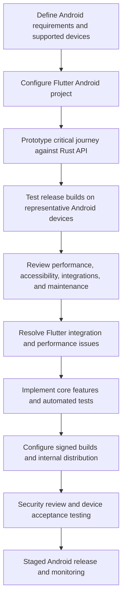

# Frontend Technology Comparison Study: Android Apps

**Purpose**: Compare frontend technology stacks for building and distributing an Android application.  
**Last Updated**: 2026-11-23  
**Study Scope**: Android is the sole deployment target. Web, Linux, Windows, macOS, and iOS delivery are outside this study's requirements.

Here, an **Android app** means an installable application distributed as an APK or through an Android App Bundle (AAB). This does not imply that every candidate uses Android-native UI controls: Flutter renders its own widgets, React Native uses Android UI components, and Tauri hosts a web frontend in Android WebView. If “native” requires the Android UI toolkit rather than just Android packaging and device access, prioritize Kotlin or Java; React Native also uses native components, but adds a JavaScript runtime and framework layer.

---

## Project Technology Decision

**Selected stack**: Rust backend, React with TypeScript browser frontend, Flutter (Dart) Android application, and PostgreSQL database.

**Flutter is the selected technology for the AREHAJ Android application.** It produces an installable Android app, not a website packaged in a WebView. Flutter renders its own widgets rather than Android toolkit controls. The app communicates with the Rust API and does not connect directly to PostgreSQL. The comparisons below remain background, not an open technology selection or evidence of implementation.

## Executive Summary

| Technology stack                         | Android UI approach                      | Device API access                                  | Main strength                                   | Main trade-off                                            |
| ---------------------------------------- | ---------------------------------------- | -------------------------------------------------- | ----------------------------------------------- | --------------------------------------------------------- |
| **Kotlin + Jetpack Compose**             | Android's declarative UI toolkit         | Direct Android SDK and Jetpack access              | Best default for a new Android-only application | Requires Android-specific expertise                       |
| **Flutter (Dart)**                       | Flutter-rendered widgets                 | Plugins, platform channels, and native integration | Productive custom UI development                | Bundled engine and occasional Kotlin/Java integration     |
| **React Native (TypeScript/JavaScript)** | Android native components through Fabric | Native modules and supported libraries             | Strong fit for React teams                      | JavaScript/native dependency and upgrade coordination     |
| **Rust + Tauri 2**                       | HTML/CSS/JavaScript in Android WebView   | Tauri plugins and custom Android integration       | Reuse of Rust logic and web UI skills           | WebView UI and mobile plugin coverage need validation     |
| **Java + Android Views**                 | Android's established View toolkit       | Direct Android SDK access                          | Existing Java applications and libraries        | More boilerplate; modern Android guidance is Kotlin-first |

**Key Findings**:

- **Flutter is selected for this project's Android application**; required device integrations, accessibility, and performance still need validation.
- **Kotlin + Jetpack Compose remains a strong general Android-only baseline**, but is not the selected project UI stack.
- **React Native is a practical choice for React/TypeScript teams**, provided required native libraries support the selected React Native release and architecture.
- **Tauri 2 supports Android**, but its UI remains WebView-based. Rust's performance and memory-safety properties do not automatically apply to the complete frontend stack.
- **Java remains viable**, particularly for maintaining an existing Android codebase, rather than as the default for a new UI.
- Electron and SwiftUI/Mac Catalyst are excluded: neither provides an officially supported Android application target. Mac Catalyst targets macOS, not Android.

**Methodology**: This is a qualitative architecture and delivery comparison, not a benchmark report. No project-specific prototype, device testing, numerical scoring, or package-count survey has been performed. Recommendations depend on team expertise and the application's actual requirements. Documentation links are provided at the end; live documentation and release compatibility were not checked during this revision.

---

## 1. Kotlin + Jetpack Compose

### Architecture Overview

Kotlin is the primary language recommended for modern Android development. Jetpack Compose provides a declarative UI toolkit integrated with Android lifecycle, accessibility, testing, and other Jetpack libraries. Compose can coexist with Android Views during incremental migration.

**Technical Stack**:

- Language: Kotlin
- UI: Jetpack Compose, typically with Material 3 components
- Platform integration: Android SDK and Jetpack libraries
- Concurrency: Kotlin coroutines and Flow
- Build and dependencies: Gradle, Android Gradle Plugin, Maven repositories
- Tooling: Android Studio, Compose previews, Android profiling and testing tools

### Production Readiness Assessment

| Area          | Assessment                                                                                                            |
| ------------- | --------------------------------------------------------------------------------------------------------------------- |
| Performance   | Direct integration with Android UI infrastructure; recomposition, layout, and startup still require profiling         |
| Security      | Android sandbox and permission model; dependencies, storage, network behavior, and native libraries still need review |
| Maintenance   | Strong alignment with Android's Kotlin-first development direction                                                    |
| Documentation | Official Android and Jetpack documentation                                                                            |
| Tooling       | First-party IDE, preview, profiling, and testing support                                                              |

### Advantages

- Direct access to Android APIs without a cross-framework plugin layer.
- Declarative UI with strong integration into Android lifecycle and state management.
- Good fit for Android-specific navigation, accessibility, adaptive layouts, and background work.
- Interoperability with Java libraries and existing Android Views.
- No additional cross-platform engine or JavaScript runtime required by the UI stack.

### Disadvantages

- Requires knowledge of Android lifecycle, permissions, Gradle, and platform behavior.
- Compose state and recomposition require careful design to avoid unnecessary work.
- Android-specific UI offers little immediate value if other platforms later become requirements.
- Platform and build-tool upgrades still require maintenance and compatibility testing.

### Production Readiness Summary

The strongest baseline for a new Android-only application. Prototype any demanding camera, background processing, offline storage, or accessibility requirements before committing to the architecture.

---

## 2. Flutter (Dart)

### Architecture Overview

Flutter uses Dart and its own widget/rendering framework rather than mapping every widget to an Android View. Android release builds compile Dart application code ahead of time to native machine code; development uses a JIT-based workflow that supports hot reload. Rendering uses Flutter's engine, including Impeller or Skia depending on the Flutter release and device configuration. AOT compilation does not remove engine, allocation, or garbage-collection costs.

**Technical Stack**:

- Language: Dart
- UI: Flutter widgets, including Material components
- Platform integration: Plugins and platform channels to Kotlin/Java; FFI for compatible native libraries
- Dependencies: pub and pub.dev
- Build: Flutter CLI with the Android Gradle toolchain
- Tooling: Flutter DevTools, Android Studio, VS Code

### Production Readiness Assessment

| Area          | Assessment                                                                                                   |
| ------------- | ------------------------------------------------------------------------------------------------------------ |
| Performance   | Suitable for many interactive apps; test frame pacing, startup, and memory on representative Android devices |
| Security      | Subject to Android's sandbox; plugins and any embedded native or web content need separate review            |
| Maintenance   | Established framework; plugin quality and release compatibility vary                                         |
| Documentation | Official framework, Android integration, and deployment guides                                               |
| Tooling       | Hot reload, widget inspection, profiling, and integration testing                                            |

### Advantages

- Productive declarative UI development with hot reload.
- Strong control over custom layouts, animation, and visual consistency.
- Established libraries for common mobile features.
- Future platform expansion is possible, although it is not a selection requirement here.

### Disadvantages

- Dart and Flutter-specific architecture require learning investment.
- Framework and engine contribute to application size and runtime resource usage.
- Unsupported device features may require Kotlin/Java plugins or platform-channel code, not necessarily FFI.
- Platform conventions, accessibility, keyboard behavior, and embedded native views require testing.

### Production Readiness Summary

A credible Android production choice, especially for custom UI or existing Flutter expertise. It should not be assumed faster, smaller, or easier than Kotlin without testing the actual application.

---

## 3. React Native (TypeScript/JavaScript)

### Architecture Overview

React Native uses React to describe interfaces rendered through native platform components. Its New Architecture includes Fabric for rendering, TurboModules for native modules, and JSI for JavaScript/native interoperability. Describing all current React Native applications as using the old asynchronous bridge is inaccurate. Hermes is commonly used as the JavaScript engine.

**Technical Stack**:

- Languages: TypeScript/JavaScript; Kotlin/Java for custom Android modules
- UI: React Native components and compatible libraries
- Runtime: Typically Hermes
- Dependencies: npm-compatible tooling, plus Android dependencies through Gradle
- Build: React Native Android tooling or Expo workflows, with Gradle underneath
- Tooling: Fast Refresh, React Native DevTools, Android profiling tools

### Production Readiness Assessment

| Area          | Assessment                                                                                                                |
| ------------- | ------------------------------------------------------------------------------------------------------------------------- |
| Performance   | Suitable for many applications; JavaScript thread work, rendering, and native integration must be profiled                |
| Security      | JavaScript is not inherently insecure; native modules, dependencies, data handling, and exposed interfaces determine risk |
| Maintenance   | Framework, Expo if used, and native-library versions must remain compatible                                               |
| Documentation | Official React Native and Expo guides, plus library-specific documentation                                                |
| Tooling       | Strong React workflow; native failures still require Android debugging skills                                             |

### Advantages

- Good fit for teams already proficient in React and TypeScript.
- Uses Android native UI components rather than a WebView for the standard UI.
- Fast Refresh supports iterative development.
- Expo can simplify common device integrations and delivery workflows when its capabilities fit the application.

### Disadvantages

- Not every npm package works on React Native; browser DOM and Node.js APIs are not generally available.
- Custom native behavior may still require Kotlin/Java code.
- Dependencies must support the chosen React Native architecture and version.
- CPU-heavy JavaScript work can affect responsiveness unless moved off the UI-critical path.

### Production Readiness Summary

A strong alternative when React expertise offers a concrete delivery advantage. Validate critical device integrations and native library compatibility rather than relying on generic code-sharing or performance claims.

---

## 4. Rust + Tauri 2

### Architecture Overview

Tauri 2 supports Android applications with a web frontend hosted in the system Android WebView and Rust application logic compiled to native code. JavaScript communicates with Rust commands through Tauri's IPC layer. Android-specific functionality may require Tauri mobile plugins or custom Kotlin integration.

Tauri is not an Android-native widget toolkit, does not require WebAssembly for its Rust logic, and does not remove WebView or JavaScript runtime costs. Other Rust UI approaches have different architectures and are not covered by this Tauri-specific assessment.

**Technical Stack**:

- Languages: Rust for native logic; HTML/CSS/JavaScript or TypeScript for UI
- Rendering: Android system WebView
- Dependencies: Cargo/crates.io and the selected web frontend's package tooling
- Build: Tauri CLI, Rust Android targets, Android SDK/NDK, and Gradle
- Platform integration: Tauri plugins, command permissions/capabilities, and custom Kotlin plugins as needed

### Production Readiness Assessment

| Area          | Assessment                                                                                                      |
| ------------- | --------------------------------------------------------------------------------------------------------------- |
| Performance   | Rust suits compute-heavy native work; UI performance depends on WebView, frontend code, and IPC                 |
| Security      | Safe Rust prevents many memory-safety errors; XSS, unsafe code, FFI, plugins, and command exposure remain risks |
| Maintenance   | Assess each required plugin's Android support and compatibility                                                 |
| Documentation | Tauri mobile, plugin, and security documentation plus Android and Rust guides                                   |
| Tooling       | Multiple toolchains: Rust, web frontend, and Android                                                            |

### Advantages

- Reuse of existing Rust domain logic or compute-intensive libraries.
- Reuse of web UI expertise without bundling a full desktop Chromium runtime.
- Explicit command and capability configuration can help constrain privileged operations.
- Safe Rust reduces memory-corruption risk within the Rust portion of the application.

### Disadvantages

- WebView-based UI does not meet a strict Android-native-controls requirement.
- Required mobile plugins may need custom development or Android-specific work.
- Rust, frontend, and Android build systems add integration complexity.
- Web content and native command boundaries require careful security design.
- Rust expertise alone does not provide Android UI, lifecycle, or accessibility expertise.

### Production Readiness Summary

A conditional option for teams with reusable Rust logic and a suitable web frontend. Prove all mandatory Android integrations in a prototype before selection. For an Android-native UI with Rust business logic, Kotlin/Compose plus a Rust library through JNI is another architecture, but introduces its own FFI and build-maintenance costs.

---

## 5. Java + Android Views

### Architecture Overview

Java can implement Android applications using the Android SDK, XML layouts, and the View toolkit. Java and Kotlin interoperate, allowing incremental adoption of Kotlin. Jetpack Compose APIs are Kotlin-oriented, so Java with Views is the appropriate comparison for a predominantly Java UI codebase.

**Technical Stack**:

- Language: Java
- UI: Android Views, XML layouts, and compatible Android UI libraries
- Platform integration: Android SDK and Java-compatible Jetpack APIs
- Dependencies and build: Gradle and Maven repositories
- Tooling: Android Studio, Layout Inspector, Android profiling and testing tools

### Production Readiness Assessment

| Area          | Assessment                                                                                              |
| ------------- | ------------------------------------------------------------------------------------------------------- |
| Performance   | Direct Android toolkit access; layout depth, allocation, startup, and threading still need optimization |
| Security      | Android sandbox applies; Java does not eliminate insecure storage, authorization, or dependency risks   |
| Maintenance   | Established option for existing apps; newer Android examples and APIs often favor Kotlin                |
| Documentation | Extensive Android references; verify Java compatibility for individual libraries                        |
| Tooling       | Mature IDE, debugger, layout, and test support                                                          |

### Advantages

- Strong fit for an existing Java Android application or experienced Java team.
- Direct Android API access and established libraries.
- Incremental Kotlin migration rather than a full rewrite.
- Android UI controls and lifecycle integration without a cross-platform runtime.

### Disadvantages

- More boilerplate than Kotlin for many UI and asynchronous programming tasks.
- Less alignment with Kotlin-first examples and Compose-based development.
- Null handling and lifecycle-aware concurrency require care.
- Choosing Java solely for familiarity can increase long-term friction with modern Android libraries.

### Production Readiness Summary

A practical maintenance and incremental-modernization choice. Prefer Kotlin/Compose for a new Android-only product unless existing assets or team constraints justify Java/Views.

---

## Benchmark Comparison Details

### Performance Metrics to Measure

There are no verified comparative measurements for this project. Universal FPS, startup, memory, or bundle-size numbers would be misleading without the same feature set, hardware, build mode, and measurement procedure.

| Metric             | Android evaluation method                                                                                |
| ------------------ | -------------------------------------------------------------------------------------------------------- |
| Startup            | Measure cold and warm launch to usable content on release builds                                         |
| Rendering          | Record frame times and jank while scrolling, navigating, and animating; account for display refresh rate |
| Memory             | Record comparable process memory, including WebView renderer processes where relevant                    |
| App size           | Compare device-delivered download and installed sizes, not an AAB against a universal APK                |
| Battery            | Exercise the same networking, background, and rendering workload                                         |
| Device integration | Test required camera, notifications, files, location, or Bluetooth workflows on physical devices         |
| Accessibility      | Test TalkBack, large fonts, focus order, contrast, and system navigation                                 |

Use representative low- and mid-range Android hardware and the intended minimum Android version. Profile release or production-equivalent builds; use Android benchmarking tools where applicable alongside framework-specific profilers. Record toolchain versions and repeat measurements.

### Ecosystem Evaluation

Raw registry size is not a measure of Android support. For each candidate, inventory required libraries and check Android compatibility, maintenance, licensing, security history, accessibility, offline behavior, and upgrade risk. Include the cost of missing plugins or custom native modules in the comparison.

---

## Recommendation Matrix

### For Android Application Requirements

| Requirement                                             | Kotlin/Compose  | Flutter                | React Native              | Rust/Tauri 2        | Java/Views                       |
| ------------------------------------------------------- | --------------- | ---------------------- | ------------------------- | ------------------- | -------------------------------- |
| Installable Android application                         | Yes             | Yes                    | Yes                       | Yes                 | Yes                              |
| Android toolkit UI rather than custom rendering/WebView | Yes             | No                     | Native components         | No                  | Yes                              |
| Direct Android SDK integration                          | Direct          | Plugin/native code     | Module/native code        | Plugin/native code  | Direct                           |
| Existing React/TypeScript team                          | New stack       | New stack              | Strong fit                | Web skills reusable | New stack                        |
| Existing Rust business logic                            | JNI integration | FFI/plugin integration | Native module integration | Built-in Rust layer | JNI integration                  |
| Custom branded UI                                       | Strong option   | Strong option          | Strong option             | Web UI option       | Possible; often more manual work |
| New Android-only default                                | Recommended     | Alternative            | Alternative               | Conditional         | Existing-codebase fit            |

### For Each Android Scenario

These are general comparison scenarios, not project decisions. **AREHAJ uses Flutter**, including for a new Android-only product; Kotlin's generic baseline recommendation does not override that selection.

#### Scenario A: New Android-Only Product

**Preferred starting point**: Kotlin + Jetpack Compose.  
**Reason**: Direct Android integration, first-party tooling, and no requirement to pay for cross-platform abstraction.

#### Scenario B: Custom UI with Flutter Expertise

**Preferred starting point**: Flutter.  
**Reason**: Existing skills and a strong widget workflow may outweigh the benefits of switching to Android-specific UI development.

#### Scenario C: Existing React/TypeScript Team

**Preferred starting point**: React Native, with Expo where suitable.  
**Reason**: Reuses React development knowledge while delivering native Android components. Verify required native integrations first.

#### Scenario D: Rust-Heavy Logic or Existing Web UI

**Candidates**: Tauri 2, or Kotlin/Compose with a Rust library.  
**Reason**: Tauri favors web UI reuse; Compose with Rust favors Android-native UI. Neither choice is automatically the fastest or most secure overall.

#### Scenario E: Existing Java Android Application

**Preferred starting point**: Maintain Java/Views and introduce Kotlin incrementally where useful.  
**Reason**: Avoid a rewrite unless measured product or maintenance needs justify it.

---

## Production Deployment Considerations

### CI/CD Pipeline Requirements

All candidates require an Android toolchain, signed release artifacts, and testing against the supported Android versions. APKs support installation and testing; AABs are publishing artifacts used by Google Play to generate device-specific APKs.

| Stack          | Build tooling                             | Android artifacts | Delivery considerations                                    |
| -------------- | ----------------------------------------- | ----------------- | ---------------------------------------------------------- |
| Kotlin/Compose | Gradle / Android Gradle Plugin            | APK / AAB         | Unit, UI, and device tests; release signing                |
| Flutter        | Flutter CLI plus Gradle                   | APK / AAB         | Dart tests, widget/integration tests, native plugin checks |
| React Native   | Gradle or compatible Expo build workflow  | APK / AAB         | JavaScript tests, native compatibility, device tests       |
| Rust/Tauri 2   | Tauri Android CLI, Cargo, SDK/NDK, Gradle | APK / AAB         | Rust/web tests, Android plugin checks, WebView behavior    |
| Java/Views     | Gradle / Android Gradle Plugin            | APK / AAB         | Unit, UI, and device tests; release signing                |

- Keep signing credentials outside source control and restrict CI access.
- Define application ID, versioning, minimum SDK, and supported architectures.
- Check current Google Play target API, privacy, permissions, and publishing policies before release.
- Validate background execution, notification permissions, process recreation, offline recovery, and low-memory behavior.
- Test through internal distribution before a staged production rollout.
- If using hosted build services, review cost, credential handling, and source-code/data-sharing implications.

### Security Considerations

**All stacks**:

- Android sandboxing is a baseline, not a guarantee of application security.
- Request minimal permissions and store sensitive keys using appropriate Android Keystore-backed mechanisms.
- Do not embed server secrets in the client; authorize sensitive operations on the server.
- Use secure transport, validate inputs, redact sensitive logs, and review dependencies.
- Protect exported Android components and validate intents, deep links, and file sharing.
- Neither native compilation nor app-store review proves that an application is secure.

**Kotlin/Compose and Java/Views**: Review lifecycle handling, component exposure, storage, networking, and any native libraries. Language-level checks do not prevent application logic flaws.

**Flutter**: Review Dart code and native plugins. Platform channels expose native functionality and must validate inputs. FFI and native dependencies can introduce memory-safety risks.

**React Native**: Review JavaScript dependencies and native modules. Never treat the JavaScript bundle as secret. Do not enable production debugging interfaces unnecessarily.

**Rust/Tauri 2**: Review WebView content, content security policy, IPC input validation, capabilities, and plugin permissions. Safe Rust reduces memory errors in safe Rust code, but does not prevent XSS, authorization flaws, unsafe/FFI bugs, or mistakes in Kotlin/Java and JavaScript code.

---

## Representative Android Evaluation Scenarios

These are proposed prototype exercises, not claimed customer case studies or measured deployment results.

| Scenario                      | Prototype objective                                                   | Candidates to prioritize                                         |
| ----------------------------- | --------------------------------------------------------------------- | ---------------------------------------------------------------- |
| Forms and offline records     | Validation, local persistence, synchronization, process recovery      | Kotlin, Flutter, React Native                                    |
| Camera and document capture   | Permissions, camera lifecycle, upload recovery, accessibility         | Kotlin; compare plugin coverage in alternatives                  |
| Branded interactive dashboard | Frame pacing, large lists, charts, memory, TalkBack                   | Kotlin, Flutter, React Native; Tauri if WebView UI is acceptable |
| Rust-based computation        | Native execution cost, cancellation, data transfer, UI responsiveness | Kotlin + Rust library or Tauri                                   |
| Existing Java product         | Migration effort, regression risk, interoperability                   | Java/Views with incremental Kotlin adoption                      |

---

## Final Recommendations

### Selected Technology for the Android Application

**Project decision: Flutter (Dart).** Build and distribute the Android application using Flutter, with plugins or Kotlin/Java integration where required for device features.

The app consumes the same Rust backend API as the React with TypeScript web frontend. PostgreSQL remains behind that API; database credentials must not be embedded in the application. Local storage and offline synchronization are separate requirements, not implied by this selection.

Flutter's own rendering model is accepted for this stack decision. Validate TalkBack, text scaling, navigation, lifecycle behavior, required plugins, and release-build performance on supported devices. Kotlin/Compose, React Native, Tauri, and Java remain comparison alternatives, not planned replacement stacks.

### Performance vs Developer Experience Trade-off

| Priority                                     | Starting point                 | What to verify                                           |
| -------------------------------------------- | ------------------------------ | -------------------------------------------------------- |
| Android integration and platform conventions | Kotlin/Compose                 | Lifecycle, accessibility, device features                |
| Custom UI with rapid iteration               | Flutter                        | Frame pacing, native plugins, resource use               |
| React team productivity                      | React Native                   | Native dependency compatibility, JavaScript workload     |
| Reusable Rust computation                    | Kotlin + Rust library or Tauri | FFI/IPC overhead, build complexity, required UI approach |
| Low-risk maintenance of an existing Java app | Java/Views                     | Regression coverage and incremental migration cost       |

### Implementation Roadmap

This is an implementation and validation sequence for the selected Flutter stack, not a delivery-time estimate. Duration depends on application scope and staffing.

---

## Conclusion

This study compares **Kotlin/Jetpack Compose, Flutter, React Native, Rust/Tauri 2, and Java/Android Views specifically for Android application development**. Desktop and web deployment coverage do not contribute to the recommendation.

**AREHAJ uses Flutter for its Android application**, React with TypeScript for the browser frontend, Rust for the backend, and PostgreSQL for authoritative storage. The comparison informs implementation risks; it does not leave the Android technology choice open. Validate the Flutter application with real device integrations and release-build measurements rather than assuming universal performance or security guarantees.

---

## Reference Documentation

These are official documentation entry points, not evidence of project-specific benchmarking. Confirm current versions and platform requirements during implementation.

- [Android Kotlin-first development](https://developer.android.com/kotlin/first)
- [Jetpack Compose](https://developer.android.com/compose)
- [Compose and Views interoperability](https://developer.android.com/develop/ui/compose/migrate/interoperability-apis)
- [Flutter architecture](https://docs.flutter.dev/resources/architectural-overview)
- [Flutter platform channels](https://docs.flutter.dev/platform-integration/platform-channels)
- [Flutter Android deployment](https://docs.flutter.dev/deployment/android)
- [React Native architecture](https://reactnative.dev/architecture/overview)
- [React Native native platform integration](https://reactnative.dev/docs/native-platform)
- [Expo documentation](https://docs.expo.dev/)
- [Tauri prerequisites](https://v2.tauri.app/start/prerequisites/)
- [Tauri Android distribution](https://v2.tauri.app/distribute/google-play/)
- [Tauri security](https://v2.tauri.app/security/)
- [Android Views](https://developer.android.com/develop/ui/views/layout/declaring-layout)
- [Android performance benchmarking](https://developer.android.com/topic/performance/benchmarking/benchmarking-overview)
- [Android App Bundles](https://developer.android.com/guide/app-bundle)
- [Android security best practices](https://developer.android.com/privacy-and-security/security-best-practices)
