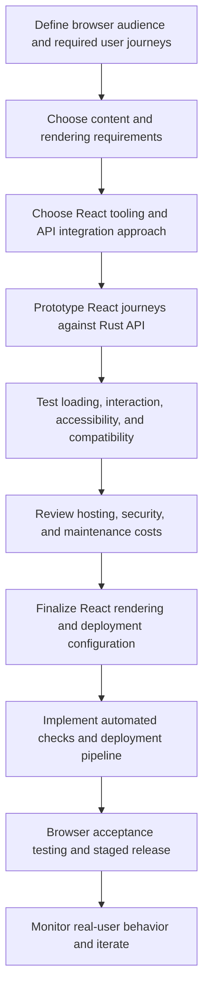

# Frontend Technology Comparison Study: Browser-Based Web

**Purpose**: Compare frontend technology stacks for the browser-based version of the product.  
**Last Updated**: 2026-11-23  
**Study Scope**: Websites and interactive interfaces accessed through a URL in desktop or mobile browsers. No Android APK/AAB, native application, Electron/Tauri wrapper, or embedded app WebView is a deployment target.

A browser application may still be described as a “web app”; in this document that means a browser-delivered interface, not an Android package. PWA installation, offline support, and service workers are optional features, not requirements or separate native delivery targets.

---

## Project Technology Decision

**Selected stack**: Rust backend, ReactJS browser frontend, Flutter (Dart) Android application, and PostgreSQL database.

**ReactJS is the selected technology for the AREHAJ web frontend.** It runs in the browser and consumes the Rust API; it does not connect directly to PostgreSQL. React Native and Flutter Web are not the selected browser stack. Next.js, Vite, JavaScript versus TypeScript, and the rendering/hosting model remain separate decisions. The comparisons below remain background, not an open framework selection or evidence of implementation.

## Executive Summary

| Technology             | Main language                 | Browser UI                                            | Main strength                                                  | Main trade-off                                                     |
| ---------------------- | ----------------------------- | ----------------------------------------------------- | -------------------------------------------------------------- | ------------------------------------------------------------------ |
| **React + Next.js**    | TypeScript/JavaScript         | HTML DOM and CSS                                      | Broad ecosystem and flexible full-stack rendering              | Server/client boundaries and dependency choices add complexity     |
| **Vue + Nuxt**         | TypeScript/JavaScript         | HTML DOM and CSS                                      | Approachable component model with integrated rendering options | Assess specialist libraries against actual needs                   |
| **Angular**            | TypeScript                    | HTML DOM and CSS                                      | Structured framework for large, long-lived applications        | More framework concepts and conventions to learn                   |
| **Svelte + SvelteKit** | TypeScript/JavaScript         | Compiled DOM updates and CSS                          | Concise components and integrated application tooling          | Smaller pool of specialist integrations and experienced developers |
| **Flutter Web**        | Dart                          | Engine-rendered UI with browser semantics integration | Reuse of Flutter UI and Dart expertise                         | Less natural fit for document-heavy, SEO-driven websites           |
| **Rust + Leptos**      | Rust; JavaScript where needed | HTML DOM, with WebAssembly for client interactivity   | Rust-centric UI and domain logic                               | Specialized tooling, hiring, and browser integration costs         |

**Key Findings**:

- For a conventional web product, start with **DOM-based frameworks**: React, Vue, Angular, or Svelte.
- **ReactJS is selected for this project**. Next.js is evaluated as a React framework option, not an adopted dependency; Vue/Nuxt remains comparison background.
- **Angular** is especially relevant when a team values standardized architecture and integrated tooling.
- **SvelteKit** is worth evaluating for a team that prefers concise components and can validate its required integrations.
- **Flutter Web** is conditional: useful for existing Flutter assets or app-like custom interfaces, but not the default for a conventional website.
- **Rust/Leptos** is a specialist option. A Rust backend does not require a Rust frontend, and WebAssembly does not guarantee faster page loads or rendering.

**Methodology**: This is a qualitative comparison, not a measured benchmark or numerical ranking. No project-specific prototype, browser testing, hiring survey, or live release verification was performed. Official reference documentation is listed at the end; verify current versions and compatibility before implementation.

---

## 1. React + Next.js

### Architecture Overview

React is a UI library. Next.js adds routing, build tooling, server rendering, static generation, and application-server capabilities. Its App Router distinguishes Server Components from Client Components. Server rendering and Server Components are related but different concepts; interactive Client Components still require browser-side JavaScript.

**Technical Stack**:

- TypeScript/JavaScript, React, HTML, and CSS.
- Next.js for routing, rendering, and deployment integration.
- Node.js-compatible package tooling; hosting requirements depend on selected features.
- A separate backend can remain authoritative for business logic and authorization.

### Production Readiness Assessment

Established tooling and a broad ecosystem make this a credible production choice. Validate compatibility among React, Next.js, component libraries, and hosting features. Cache behavior and server/client boundaries require explicit design.

### Advantages

- Extensive component, testing, accessibility, and data-management options.
- Static generation and server rendering support public, indexable pages.
- Can combine content pages with rich interactive sections.
- Large pool of React knowledge and reusable integrations.

### Disadvantages

- Application architecture can become complex when combining server components, hydration, caching, and mutations.
- Poorly chosen dependencies or client boundaries can ship excessive JavaScript.
- A separate API plus a Next.js server may introduce an additional deployment layer.

### Best Fit

A product needing both public content and substantial interactive features, particularly with existing React expertise. A client-rendered React application built with Vite is a simpler alternative when server rendering and Next.js server features provide no benefit.

---

## 2. Vue + Nuxt

### Architecture Overview

Vue provides reactive components, commonly authored as single-file components. Nuxt adds routing, rendering modes, data-loading conventions, and server capabilities. It can support server-rendered, prerendered, and client-rendered routes, subject to the chosen deployment configuration.

**Technical Stack**:

- TypeScript/JavaScript, Vue single-file components, HTML templates, and CSS.
- Nuxt for application structure and rendering.
- Node.js-compatible package tooling; Nitro provides Nuxt's server infrastructure.
- An existing backend can supply APIs without moving business logic into Nuxt.

### Production Readiness Assessment

A mature candidate for conventional web interfaces. Validate Nuxt module compatibility, data-fetching behavior, hydration, and the selected hosting adapter or preset.

### Advantages

- Familiar template-based component model and incremental learning path.
- Integrated routing and rendering conventions reduce some assembly work.
- Suitable for public pages, dashboards, and form-heavy applications.
- Vue can also be used without Nuxt for simpler client-only interfaces.

### Disadvantages

- Automatic imports and conventions can obscure behavior until the team understands them.
- Module compatibility and framework upgrades still require maintenance.
- Specialist integration availability must be checked rather than inferred from registry size.

### Best Fit

A team seeking a conventional DOM-based frontend with approachable component authoring and integrated rendering options.

---

## 3. Angular

### Architecture Overview

Angular is an integrated TypeScript framework with components, routing, dependency injection, forms, and HTTP tooling. Angular CLI supports application builds, and Angular provides server rendering and prerendering capabilities. Angular is not the same project as the legacy AngularJS framework.

**Technical Stack**:

- TypeScript, HTML templates, and CSS.
- Angular components, signals, dependency injection, and reactive tooling such as RxJS where appropriate.
- Angular CLI and Node.js-compatible package tooling.
- Static hosting for client-only builds, or a compatible server deployment for request-time rendering.

### Production Readiness Assessment

A credible choice for long-lived business applications with multiple contributors. Check framework/library compatibility and keep upgrade work within the product's maintenance plan.

### Advantages

- Consistent framework conventions across teams and features.
- Integrated routing, forms, dependency injection, and testing support.
- Strong fit for complex workflows and large form-based interfaces.
- Official tooling reduces the need to choose every architectural building block separately.

### Disadvantages

- Larger conceptual learning surface than a minimal UI library setup.
- Framework conventions can feel heavy for a small website.
- Performance still depends on dependency selection, rendering strategy, and application design.

### Best Fit

A substantial business application where architectural consistency, existing Angular skills, and team coordination matter more than a minimal framework footprint.

---

## 4. Svelte + SvelteKit

### Architecture Overview

Svelte compiles components into browser code rather than relying on React-style virtual DOM reconciliation. It still uses client-side runtime code; “compiled” does not mean zero runtime or guaranteed superior performance. SvelteKit adds routing, server rendering, prerendering, data loading, and deployment adapters.

**Technical Stack**:

- TypeScript/JavaScript, Svelte components, HTML, and CSS.
- SvelteKit with Vite-based tooling.
- Deployment adapters for supported server environments or static output.
- Integration with a separate backend through standard HTTP APIs.

### Production Readiness Assessment

A viable production candidate when required UI components, accessibility behavior, and deployment adapters satisfy the product's needs. Assess the team's ability to maintain framework-specific integrations.

### Advantages

- Concise components with relatively little UI boilerplate.
- Integrated routing and data-loading model through SvelteKit.
- Supports content-oriented and interactive browser experiences.
- Compiler-driven UI updates can be efficient, depending on the workload.

### Disadvantages

- Fewer specialist integrations and experienced developers than some larger ecosystems.
- Framework-version compatibility matters for third-party components.
- Complex browser behavior still requires HTML, CSS, JavaScript, and accessibility expertise.

### Best Fit

A team that values concise UI code and can confirm the availability of its essential components and integrations through a prototype.

---

## 5. Flutter Web

### Architecture Overview

Flutter Web compiles Dart for the browser and renders through Flutter's engine rather than treating each widget as a conventional HTML element. Depending on build mode and browser support, output can involve JavaScript and WebAssembly, with renderers such as CanvasKit or skwasm. Exact renderer support and fallback behavior must be checked against the selected Flutter release.

**Technical Stack**:

- Dart and Flutter widgets.
- Flutter web build tooling and browser-supported rendering paths.
- HTTP APIs for backend communication; browser restrictions still apply.
- Browser semantics integration for accessibility, which requires practical testing.

### Production Readiness Assessment

Suitable for some app-like browser interfaces, especially when reusing Flutter code. Evaluate first-load cost, text behavior, browser navigation, accessibility, plugins, and mobile-browser compatibility before selection.

### Advantages

- Reuses Flutter UI, domain code, and team expertise where those assets already exist.
- Strong control over custom visuals and interactive layouts.
- Can share code with the separate Android product if it also uses Flutter, although shared code is a benefit rather than a browser requirement.

### Disadvantages

- Not the default choice for text-heavy, search-indexed, document-oriented websites.
- Engine and application downloads can affect initial loading; measure actual builds.
- Browser-native behavior such as selection, focus, deep links, and accessibility needs explicit validation.
- Flutter plugins are not automatically compatible with web builds; browser APIs cannot reproduce every Android capability.

### Best Fit

An app-like browser interface with valuable existing Flutter assets and no requirement that conflicts with its rendering model. Avoid selecting it solely because Flutter is a candidate for Android.

---

## 6. Rust + Leptos

### Architecture Overview

Leptos is a Rust web UI framework supporting reactive DOM interfaces. It can render HTML on the server and hydrate interactive client code compiled to WebAssembly, or support client-rendered applications. JavaScript interoperability may be needed for browser APIs and existing web libraries. This is not a Tauri build and produces no native application package.

**Technical Stack**:

- Rust, Cargo, and Leptos components.
- WebAssembly for client-side Rust execution, with browser bindings and generated JavaScript glue.
- Server rendering typically integrated with a compatible Rust server framework.
- CSS and normal web accessibility practices remain necessary.

### Production Readiness Assessment

A specialist candidate for Rust-experienced teams. Validate component availability, build/deployment workflow, hydration behavior, and browser integrations before committing.

### Advantages

- Rust typing and reuse of suitable Rust models or domain logic.
- DOM-based output rather than a required canvas-rendered UI.
- Server rendering is available for initial HTML delivery.
- Useful when maintaining a Rust-centric toolchain has a concrete organizational benefit.

### Disadvantages

- More specialized frontend hiring, documentation, and component ecosystem.
- WebAssembly payload, initialization, and interoperation costs can offset computational advantages.
- Existing JavaScript libraries may require wrappers or additional integration work.
- Rust memory safety does not prevent XSS, authorization errors, unsafe FFI bugs, or insecure application logic.

### Best Fit

A Rust-capable team with a demonstrated reuse or workload advantage and willingness to validate a less conventional frontend stack. A Rust backend plus a TypeScript frontend is often a simpler alternative.

---

## Benchmark Comparison Details

### Browser Metrics to Measure

No comparative performance measurements have been collected for this project. Framework names alone do not establish page speed, memory usage, bundle size, or responsiveness.

| Metric             | Evaluation approach                                                                                                |
| ------------------ | ------------------------------------------------------------------------------------------------------------------ |
| Initial delivery   | Compare transferred HTML, CSS, JavaScript, WebAssembly, fonts, and other assets with equivalent caching conditions |
| Loading experience | Measure LCP and layout stability on representative pages and mobile connections                                    |
| Interaction        | Measure INP and test critical interactions; inspect long tasks and main-thread blocking                            |
| Navigation         | Test first visit, cached repeat visit, deep links, reloads, and browser back/forward behavior                      |
| Memory             | Exercise large lists, repeated navigation, and long sessions on constrained devices                                |
| Accessibility      | Test semantic structure, keyboard navigation, screen readers, focus, zoom, and contrast                            |
| Search visibility  | Check indexable HTML, metadata, canonical URLs, status codes, and actual indexing where required                   |
| Reliability        | Test network failures, expired sessions, server errors, and recovery                                               |

Use production builds, the same feature set and backend responses, and a defined browser/device matrix. Include Chromium, Firefox, and WebKit/Safari where audience requirements justify them. Separate laboratory results from real-user field data; a Lighthouse score alone is not proof of production performance or accessibility.

### Ecosystem Evaluation

Assess the specific components the product needs: accessible forms, tables, rich text, charts, localization, authentication integration, and testing. Raw package counts and framework popularity do not prove suitability, maintenance quality, license compatibility, or security.

---

## Recommendation Matrix

The matrix and scenarios below describe general suitability. **AREHAJ uses ReactJS for the web version**; they do not reopen that decision or imply adoption of Next.js.

| Requirement                                   | Candidates to prioritize                        | Qualification                                                       |
| --------------------------------------------- | ----------------------------------------------- | ------------------------------------------------------------------- |
| Public content and search visibility          | React/Next.js, Vue/Nuxt, Angular SSR, SvelteKit | Configure rendering, metadata, and HTTP behavior correctly          |
| Authenticated dashboard using an existing API | React, Vue, Angular, Svelte                     | A client-only build may be sufficient; server rendering is optional |
| Large team with standardized architecture     | Angular; established React/Vue conventions      | Team practices remain important regardless of framework             |
| Existing React expertise                      | React/Next.js or React/Vite                     | Choose Next.js only if its features justify the extra layer         |
| Existing Flutter UI assets                    | Flutter Web                                     | Validate browser behavior and accessibility first                   |
| Existing Rust expertise and reusable logic    | Leptos or a TypeScript frontend with a Rust API | Rust backend adoption does not imply Rust frontend adoption         |
| Minimal client interactivity                  | Static HTML or server-rendered templates        | A substantial client framework may be unnecessary                   |

### Scenario A: Public Website with Interactive Features

**Initial shortlist**: Vue/Nuxt, React/Next.js, or SvelteKit. Use static generation or server rendering where beneficial, and avoid sending unnecessary client code.

### Scenario B: Authenticated Business Interface

**Initial shortlist**: React, Vue, Angular, or Svelte. Decide whether request-time frontend server rendering provides enough value to justify an additional server deployment.

### Scenario C: Android and Browser Products Share Flutter Code

**Conditional candidate**: Flutter Web. Prototype the browser version separately; sharing code does not establish acceptable loading, semantics, accessibility, or SEO.

### Scenario D: Rust-Oriented Organization

**Default architectural option**: A Rust API with a conventional DOM frontend. Evaluate Leptos if Rust UI reuse or a unified language provides a measurable advantage.

---

## Production Deployment Considerations

### Hosting and CI/CD

| Rendering model               | Build artifacts                                      | Hosting implications                                                                     |
| ----------------------------- | ---------------------------------------------------- | ---------------------------------------------------------------------------------------- |
| Client-rendered frontend      | HTML, CSS, JavaScript, assets; sometimes WebAssembly | Static hosting/CDN with correct route fallback and cache policy                          |
| Prerendered/static pages      | Generated HTML and assets                            | Static hosting; content freshness may require rebuilds or platform-specific regeneration |
| Request-time server rendering | Server application plus browser assets               | Compatible server runtime, monitoring, scaling, secrets, and cache management            |
| Mixed rendering               | Combination of server and static artifacts           | Confirm framework features work with the selected host and deployment configuration      |

- Keep backend responsibilities explicit: authentication, authorization, business rules, and data validation cannot rely on the browser.
- If an existing backend already serves the product, avoid adding a second application server without a concrete benefit.
- Configure HTTPS, compression, caching, redirects, security headers, error pages, and source-map access appropriately.
- Test responsive layouts, deep links, browser history, localization, and supported browser versions.
- Deploy with rollback capability and monitor errors and real-user performance.
- No Android signing keys, Play Store submission, APK generation, or native SDK pipeline is needed for this scope.
- Review cost, data residency, logs, and source-code sharing when selecting hosted CI, analytics, or deployment services.

### Security Considerations

All candidates execute untrusted-client-facing code and need secure application design.

- Never include server secrets in browser bundles, WebAssembly, public configuration, or source maps. Compilation is not secret storage.
- Enforce authorization and validate sensitive operations on the backend.
- Escape untrusted content and carefully review raw HTML, URL handling, and rich-text rendering.
- Use an appropriate Content Security Policy; framework escaping alone does not eliminate XSS.
- Design session handling deliberately, including cookie flags, CSRF defenses where applicable, and expiry/revocation behavior.
- Treat CORS as a browser access policy, not authentication or authorization.
- Audit dependencies and server-rendering code, and keep framework/runtime versions supported.
- Avoid caching personalized responses as public content or exposing private data through hydration payloads.
- Rust memory safety, TypeScript types, and Flutter compilation do not substitute for these controls.

---

## Representative Evaluation Scenarios

These are prototype exercises, not claimed customer case studies.

1. **Public page**: Indexable content, responsive navigation, metadata, and fast first load.
2. **Authenticated workflow**: Login, authorization failure, form validation, session expiry, and recovery.
3. **Data-heavy screen**: Filtering, pagination, charts or tables, keyboard access, and realistic network latency.
4. **Mobile browser session**: Touch interaction, soft keyboard, zoom, constrained memory, and unstable connectivity.
5. **Deployment failure**: API outage, stale cached assets, frontend/backend version mismatch, and rollback.

Run the same required journeys for each shortlisted stack and record delivery effort alongside browser measurements.

---

## Final Recommendations

### Best Starting Point for the Browser Version

**Project decision: ReactJS for the browser frontend.** It communicates with the Rust backend API, which owns authorization, business rules, and access to PostgreSQL. Flutter is used for the separate Android application, not the browser version.

Choose React tooling and rendering separately:

- **Authenticated interface backed by the Rust API**: A client-rendered React build, for example using Vite, may be sufficient.
- **Public content requiring server rendering or prerendering**: Evaluate compatible React tooling, such as Next.js, only where requirements justify it. Any additional server layer must have an explicit role alongside the Rust backend.
- **Language and hosting**: JavaScript versus TypeScript, routing, build tooling, and hosting remain implementation decisions.

Vue, Angular, Svelte, Flutter Web, and Leptos remain comparison background rather than selected project frontends.

### Implementation Roadmap

This is an implementation and validation sequence for the selected ReactJS frontend, not a delivery estimate.

---

## Conclusion

The browser version should be evaluated as a web product, not as an Android application wrapped around web content. Its selection criteria are browser behavior, accessibility, initial delivery, interaction quality, search visibility where required, and long-term maintainability.

**AREHAJ uses ReactJS for the browser frontend**, with a Rust backend and PostgreSQL database. Flutter serves the separate Android application. Validate critical React journeys in production-equivalent browser builds; the remaining decisions concern tooling, rendering, hosting, and integration rather than selection of another frontend framework.

---

## Reference Documentation

Official documentation entry points are provided for follow-up. Links and current release details were not live-verified during this revision.

- [React documentation](https://react.dev/)
- [Next.js documentation](https://nextjs.org/docs)
- [Vue documentation](https://vuejs.org/guide/introduction.html)
- [Nuxt documentation](https://nuxt.com/docs)
- [Angular documentation](https://angular.dev/)
- [Svelte and SvelteKit documentation](https://svelte.dev/docs)
- [Vite documentation](https://vite.dev/guide/)
- [Flutter Web documentation](https://docs.flutter.dev/platform-integration/web)
- [Flutter web renderers](https://docs.flutter.dev/platform-integration/web/renderers)
- [Leptos documentation](https://book.leptos.dev/)
- [Core Web Vitals](https://web.dev/articles/vitals)
- [WCAG accessibility guidelines](https://www.w3.org/WAI/standards-guidelines/wcag/)
- [OWASP Cheat Sheet Series](https://cheatsheetseries.owasp.org/)
